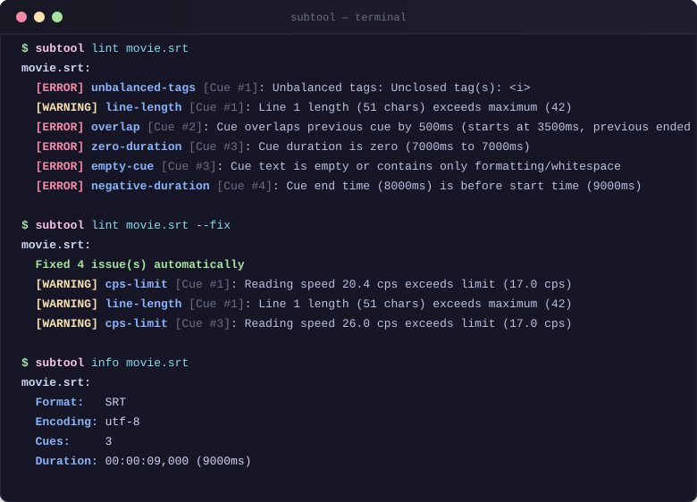

# subtitle-tools

[](https://github.com/YusufBeratZengin/subtitle-tools/actions/workflows/ci.yml)
[](https://pypi.org/project/subtitle-tools/)
[](https://www.python.org/)
[](LICENSE)

[English](README.md) | [Turkce](README.tr.md)

A zero-dependency Python CLI and library to convert, transform, fix, and lint subtitle files across SubRip (`.srt`), WebVTT (`.vtt`), and Advanced SubStation Alpha (`.ass` / `.ssa`).



## Why subtitle-tools?

- **Zero runtime dependencies**: Pure standard library Python >= 3.10. No binary wheels, FFmpeg installations, or bulky C extensions required.
- **Multi-format round-trip fidelity**: Accurate bidirectional conversions across SubRip (`.srt`), WebVTT (`.vtt`), and ASS/SSA (`.ass`), preserving styles, cue settings, comments, and unknown sections verbatim.
- **Built-in linting & auto-repair**: Automatically flags timing overlaps, zero/negative durations, line length limits, and reading speed (CPS) violations—and heals fixable issues safely with `--fix`.

## Quick Start

Until the first PyPI release, install from a clone by running `pip install -e .` in the repository root.

After the first PyPI release, install via pip:

```bash
# Install package
pip install subtitle-tools

# Inspect subtitle file metadata and encoding
subtool info movie.srt

# Lint and automatically repair timing/tag issues
subtool lint movie.srt --fix

# Convert from SRT to WebVTT
subtool convert movie.srt movie.vtt
```

For local development and testing:

```bash
git clone https://github.com/YusufBeratZengin/subtitle-tools.git
cd subtitle-tools
pip install -e ".[dev]"
pytest
```

## Usage Examples

Examples: see [examples/](examples/) for the small SRT sample and its converted WebVTT file.
Real output on Windows (conversion succeeds silently):

```console
$ subtool lint examples/sample.srt

examples\sample.srt:
  No issues found.
$ subtool convert examples/sample.srt examples/sample.vtt
```

### CLI Reference (`subtool`)

#### Convert formats
```bash
# Convert between formats by file extension
subtool convert input.srt output.vtt
subtool convert input.vtt output.ass

# Explicit format specification
subtool convert input.txt output.vtt --from-format srt --to-format vtt
```

#### Shift timing
```bash
# Shift forward by 1500 milliseconds
subtool shift input.srt -o shifted.srt --by 1500ms

# Shift backward by 2 seconds
subtool shift input.srt -o shifted.srt --by -2s

# Align the first cue to start at exactly 00:01:00.000
subtool shift input.srt -o shifted.srt --to 00:01:00.000

# Overwrite file in place
subtool shift input.srt --in-place --by 500ms
```

#### Scale framerate / timing
```bash
# Convert from 23.976 fps to 25 fps (PAL speedup)
subtool scale input.srt -o scaled.srt --from-fps 23.976 --to-fps 25

# Convert from 25 fps to 23.976 fps
subtool scale input.srt -o scaled.srt --from-fps 25 --to-fps 23.976

# Direct timing multiplier
subtool scale input.srt -o scaled.srt --factor 1.05
```

#### Merge dual-language subtitles
```bash
# Merge English and Turkish subtitles into stacked dual cues
subtool merge english.srt turkish.srt -o dual.srt

# Custom line separator
subtool merge english.srt turkish.srt -o dual.srt --separator " | "
```

#### Split subtitles by duration
```bash
# Split into 20-minute chunks
subtool split input.srt --duration 20m -o part

# Split every 1200 seconds
subtool split input.srt --duration 1200s
```

#### Join multiple files
```bash
# Concatenate files with a 1-second gap
subtool join part1.srt part2.srt part3.srt -o full.srt --gap 1000ms
```

#### Renumber cues
```bash
subtool renumber input.srt -o renumbered.srt --start 1
```

#### Strip formatting tags
```bash
# Remove <i>, <b>, <font>, and ASS override tags
subtool strip-tags input.srt -o clean.srt
```

#### Lint and auto-fix
```bash
# Lint files and output human-readable report
subtool lint *.srt

# Output machine-readable JSON report
subtool lint *.srt --format json

# Auto-repair fixable issues in place
subtool lint *.srt --fix

# Configure linting thresholds
subtool lint *.srt --max-cps 18 --max-line-length 40 --max-lines 2 --min-duration 400
```

#### Inspect subtitle file metadata
```bash
subtool info *.srt *.vtt *.ass
```

### Python Library API

`subtitle-tools` can be imported directly in Python applications:

```python
from subtitle_tools import parse, write, shift, merge, lint_document, LintConfig

# Parse subtitle text
with open("input.srt", "r", encoding="utf-8") as f:
    doc = parse(f.read(), fmt="srt")

# Shift cues forward by 1.5 seconds
shifted_doc = shift(doc, by_ms=1500)

# Lint document with custom thresholds
config = LintConfig(max_cps=17.0, max_line_length=42)
issues = lint_document(shifted_doc, config=config)

for issue in issues:
    print(f"[{issue.severity.upper()}] {issue.rule_id}: {issue.message}")

# Serialize to WebVTT
vtt_text = write(shifted_doc, fmt="vtt")
```

## Configuration

### Linting Options & Thresholds

When running `subtool lint`, the following options configure validation thresholds:

| CLI Option | Default | Description |
| ---------- | ------- | ----------- |
| `--max-cps` | `17.0` | Maximum reading speed threshold in characters per second. |
| `--max-line-length` | `42` | Maximum character count per line within a cue. |
| `--max-lines` | `2` | Maximum allowed lines per cue. |
| `--min-duration` | `500` | Minimum cue duration in milliseconds. |
| `--max-duration` | `7000` | Maximum cue duration in milliseconds. |
| `--fix` | `False` | Automatically repair safe defects in-place. |
| `--strict` | `False` | Exit with error status code on warnings as well as errors. |
| `--format` | `text` | Output format (`text` for terminal, `json` for CI/tooling). |

### Linting Rules

| Rule ID | Severity | Description | Fixable via `--fix` |
| ------- | -------- | ----------- | ------------------- |
| `overlap` | Error | Cue starts before the previous cue ends. | Yes (if overlap <= 1500ms) |
| `negative-duration` | Error | Cue end timestamp is before its start timestamp. | Yes (swapped or adjusted) |
| `zero-duration` | Error | Cue end timestamp equals its start timestamp. | Yes (set to min duration) |
| `too-short-duration` | Warning | Cue duration is shorter than minimum (default: 500ms). | No |
| `too-long-duration` | Warning | Cue duration exceeds maximum (default: 7000ms). | No |
| `cps-limit` | Warning | Characters per second exceeds reading limit (default: 17 cps). | No |
| `line-length` | Warning | Single line exceeds maximum character length (default: 42 chars). | No |
| `line-count` | Warning | Cue has more lines than permitted (default: 2 lines). | No |
| `empty-cue` | Error | Cue contains no visible text (whitespace or tags only). | Yes (removed) |
| `unbalanced-tags` | Error | Unclosed or mismatched HTML/VTT or ASS styling tags. | Yes (closed or stripped) |
| `encoding-issue` | Warning | UTF-8 Byte Order Mark (BOM) or mixed CRLF/LF line endings. | Yes (normalized) |

### Encoding Detection Order

When reading subtitle files without an explicit `--encoding` argument, `subtitle-tools` applies the following fallback sequence:

1. **`utf-8-sig`**: Checks for the 3-byte UTF-8 BOM (`0xEF, 0xBB, 0xBF`).
2. **`utf-8`**: Strict UTF-8 decoding.
3. **`cp1254` / `cp1252`**: If non-UTF-8 bytes contain Windows-1254 characteristic Turkish characters (`ş`, `ğ`, `ı`, `Ş`, `Ğ`, `İ`), `cp1254` is applied. Otherwise, Windows-1252 (Western European ANSI) is used.
4. **`cp1254`**: Fallback attempt for Windows Turkish ANSI if CP1252 fails on undefined byte ranges.
5. **`latin-1`**: ISO-8859-1 fallback that maps all single-byte values (0x00 to 0xFF) safely without decoding errors.

## FAQ & Limitations

**Q: Which subtitle formats are supported?**  
A: `subtitle-tools` supports SubRip (`.srt`), WebVTT (`.vtt`), and SubStation Alpha / Advanced SubStation Alpha (`.ass`, `.ssa`).

**Q: Does subtitle-tools support bitmap or image-based subtitles (PGS / SUP, VobSub `.sub`/`.idx`)?**  
A: No. `subtitle-tools` is strictly focused on text-based subtitle manipulation. For rasterized streams like Blu-ray PGS (`.sup`) or DVD VobSub, optical character recognition (OCR) tools such as Subtitle Edit or Tesseract must be used first to extract text.

**Q: How does the auto-fixing engine decide what is safe to modify?**  
A: `--fix` only modifies unambiguous defects: it removes completely empty cues, closes unbalanced or dangling HTML/ASS formatting tags, normalizes mixed newlines, resolves slight overlaps within the configured threshold, and repairs negative/zero durations. Subjective issues (such as text length or CPS speed) are flagged for human review.

**Q: Can I run this in serverless or lightweight container environments without installing third-party packages?**  
A: Yes. `subtitle-tools` has zero third-party runtime dependencies. A standard Python 3.10+ interpreter is all that is required.

## Contributing

Contributions are welcome! Please review [CONTRIBUTING.md](CONTRIBUTING.md) for contribution guidelines, development workflow, and coding standards.

### Running Tests & Quality Checks

Run tests with coverage:

```bash
pytest
```

Run linter and static type checker:

```bash
ruff check .
mypy src
```

Tests can also run with zero dependencies using standard library `unittest`:

```bash
python -m unittest discover -s tests
```

## License

This project is licensed under the MIT License - see the [LICENSE](LICENSE) file for details.

Copyright (c) 2026 Yusuf Berat Zengin.
