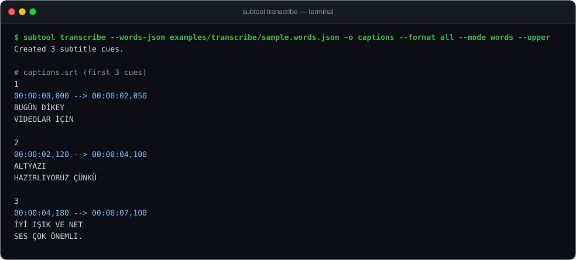

# `subtool transcribe`: offline, word-timed subtitles

`subtool transcribe` turns local speech into word-timed SRT, WebVTT and karaoke ASS
subtitles for short vertical videos (Shorts, Reels, TikTok). It uses
[faster-whisper](https://github.com/SYSTRAN/faster-whisper) on your own machine and
writes its files with the same SRT, WebVTT and ASS writers as the rest of
`subtitle-tools`.

This feature started as the separate `altyazi-tr` project and now ships here as an
optional extra.



- **Offline and private**: no external API calls, no telemetry and no automatic model
  downloads. Recordings and subtitle text stay on your machine.
- **Built for 9:16 video**: short lines (18 characters by default), pause-aware
  breaks and active-word karaoke highlighting in ASS.
- **Turkish language rules**: correct uppercase (`i→İ`, `ı→I`), no stranded
  conjunctions (`ve`, `ama`, `ki`, `de`/`da`) at line ends, and a report of
  low-confidence words. Other Whisper languages work too, with plain casing.

## Install

The core package has no dependencies. Speech recognition is an optional extra:

```sh
pip install "subtitle-tools[transcribe]"

# Optional: bundled ffmpeg for --burn and YAML style files
pip install "subtitle-tools[transcribe,ffmpeg,yaml]"
```

Until the first PyPI release, install from a clone with
`pip install -e ".[transcribe]"`.

Without the extra, `subtool transcribe --words-json ...` still works, because it
never loads faster-whisper. Transcribing media without the extra exits with code 1
and prints the install command.

## Try it without a model

The repository ships deterministic word timings
([`examples/transcribe/sample.words.json`](../examples/transcribe/sample.words.json)):

```sh
subtool transcribe --words-json examples/transcribe/sample.words.json -o captions --format all --mode words --upper
```

This writes `captions.srt`, `captions.vtt` and `captions.ass` to the current
directory. The results are checked in as
[`examples/transcribe/sample.srt`](../examples/transcribe/sample.srt),
[`sample.vtt`](../examples/transcribe/sample.vtt) and
[`sample.ass`](../examples/transcribe/sample.ass).

## Usage

### Transcribe a local video

With a faster-whisper model in your local cache or a local model directory:

```sh
subtool transcribe video.mp4 --model ./models/small -o captions --format all
```

SRT excerpt:

```srt
1
00:00:00,000 --> 00:00:02,050
BUGÜN DİKEY
VİDEOLAR İÇİN

2
00:00:02,120 --> 00:00:04,100
ALTYAZI
HAZIRLIYORUZ ÇÜNKÜ
```

### Karaoke ASS (active word highlight)

`--mode words` highlights each word while it is spoken and removes the highlight
during pauses:

```sh
subtool transcribe video.mp4 --model ./models/small -o karaoke --format ass --mode words --upper --report json
```

```ass
Dialogue: 0,0:00:00.00,0:00:00.42,Default,,0,0,0,,{\1c&H00FFFF&\1a&H00&}BUGÜN{\rDefault} DİKEY\NVİDEOLAR İÇİN
Dialogue: 0,0:00:00.42,0:00:00.48,Default,,0,0,0,,BUGÜN DİKEY\NVİDEOLAR İÇİN
Dialogue: 0,0:00:00.48,0:00:00.95,Default,,0,0,0,,BUGÜN {\1c&H00FFFF&\1a&H00&}DİKEY{\rDefault}\NVİDEOLAR İÇİN
```

### Burn subtitles into the video (`--burn`)

```sh
subtool transcribe video.mp4 --model ./models/small -o rendered --format ass --burn --style examples/transcribe/style.json --position middle
```

This produces `rendered.burned.mp4` (H.264 `yuv420p`, AAC audio). It needs ffmpeg
with libass, either on `PATH` or from the `ffmpeg` extra.

### Transcribe once, re-layout many times

```sh
# 1. Transcribe once and save the recognized words
subtool transcribe video.mp4 --model ./models/small --save-words words.json -o captions

# 2. Re-layout or re-style from JSON in milliseconds, without the model
subtool transcribe --words-json words.json -o captions_v2 --format all --mode words --max-chars 14 --upper
```

The generated files are ordinary subtitles, so the other `subtool` commands work on
them, for example `subtool lint captions.srt` or `subtool shift captions.srt --by 200ms`.

### Python API

```python
from subtitle_tools import write
from subtitle_tools.transcribe import LayoutConfig, Word, layout, to_document

words = [Word(0.0, 0.4, "iyi", 0.95), Word(0.5, 1.0, "ışık", 0.90)]
cues = layout(words, LayoutConfig(upper=True), duration=2.0)

srt_text = write(to_document(cues, "srt"))
ass_karaoke = write(to_document(cues, "ass", karaoke=True))
```

| Entry point | Purpose |
| --- | --- |
| `Word(start, end, text, prob)` | Validated, immutable timed token (seconds, probability 0–1). |
| `WordCue(start, end, lines)` | Layout result: lines of `Word` tuples. `to_cue()` returns the core `Cue`. |
| `layout(words, config, duration=None)` | Pure layout engine: line limits, breaks and reading speed. |
| `layout_warnings(cues, config)` | Constraint violations that could not be avoided. |
| `turkish_upper(text)` | Turkish uppercase (`i→İ`, `ı→I`). |
| `to_document(cues, fmt, style=None, karaoke=False)` | Core `SubtitleDocument` for `srt`, `vtt` or `ass`. |
| `transcribe(path, ...)` | Local faster-whisper recognition, never downloads. |
| `load_style(path)` / `Style` | Validated JSON/YAML ASS style. |
| `burn.burn(source, subtitles, output)` | Burns ASS into video with local ffmpeg. |

## Configuration

### Layout options

| Option | Default | Description |
| --- | :---: | --- |
| `--mode {words,groups}` | `groups` | `groups` shows word groups; `words` highlights each spoken word in ASS. |
| `--max-chars` | `18` | Maximum characters per line, including spaces and punctuation. |
| `--max-lines` | `2` | Maximum lines per cue (1–4). |
| `--pause-threshold` | `0.6` | Silence in seconds that forces a new cue. |
| `--min-duration` | `0.8` | Minimum on-screen time in seconds. |
| `--max-cps` | `18.0` | Maximum reading speed in characters per second. |
| `--upper` | off | Uppercase output (Turkish dotted/dotless I for `tr` and `az`). |
| `--confidence` | `0.6` | Words below this probability are listed in the report. |

### ASS style

Pass a JSON or YAML file with `--style` (see
[`examples/transcribe/style.json`](../examples/transcribe/style.json) and
[`style.yaml`](../examples/transcribe/style.yaml); YAML needs the `yaml` extra):

```json
{
  "font": "DejaVu Sans",
  "font_size": 72,
  "primary_color": "&H00FFFFFF",
  "highlight_color": "&H0000FFFF",
  "outline_color": "&H00000000",
  "outline": 4.0,
  "bold": true,
  "position": "bottom",
  "margin_v": 320
}
```

- **Canvas**: 1080×1920 reference canvas for 9:16 video.
- **Colors**: ASS `&HAABBGGRR` (alpha, blue, green, red in hex).
- **Position**: `bottom` (`margin_v` from the bottom), `middle`, or `upper`
  (`margin_v` from the top).

### Exit codes

| Code | Meaning |
| :---: | --- |
| `0` | Subtitles written. |
| `1` | Processing error: missing or empty input, model not in the local cache, missing `transcribe` extra, output collision, or invalid style. |
| `2` | Invalid command-line arguments. |

Existing files are never overwritten; every output must be new.

### Report JSON

`--report json` writes `<stem>.report.json`
([example](../examples/transcribe/report.json)):

| Field | Type | Description |
| --- | --- | --- |
| `version` | string | `subtitle-tools` version. |
| `language` | string | Language code used. |
| `duration` | float | Media duration in seconds (at least the last word end). |
| `device` | string | `cpu`, `cuda`, or `none` for `--words-json`. |
| `compute_type` | string | `int8`, `float16`, or `none`. |
| `cue_count` | integer | Number of cues produced. |
| `confidence_threshold` | float | Threshold for low-confidence words. |
| `low_confidence_words` | array | `{start, end, text, prob}` below the threshold. |
| `layout_warnings` | array | `{cue, codes}` for cues that exceed layout targets. |

## FAQ and limitations

### Offline operation and models

Installing packages and getting a model the first time need internet access. The
command itself **never downloads a model**: it always passes
`local_files_only=True`. A named model such as `small` must already be in your
Hugging Face cache, or pass a complete local faster-whisper/CTranslate2 model
directory with `--model /path/to/model`. See upstream
[model conversion](https://github.com/SYSTRAN/faster-whisper#model-conversion).

| Model | Parameters (approx.) | Speed | Accuracy trade-off |
| --- | ---: | --- | --- |
| `tiny` | 39M | Fastest | Higher Turkish error rate |
| `base` | 74M | Fast | Quick drafts |
| `small` (recommended) | 244M | Moderate | Practical start for Turkish speech |
| `medium` | 769M | Slower | Better in noisy speech |
| `large-v3` | 1,550M | Slowest | Best accuracy, needs more RAM/VRAM |

### CPU and GPU

- `--device auto` uses CUDA when CTranslate2 finds a GPU, otherwise CPU with `int8`.
  If CUDA fails at runtime it retries once on CPU `int8`.
- `--device cpu` forces CPU.
- `--compute-type` overrides the default precision (`int8` on CPU, `float16` on CUDA).

### Known limitations

- No speaker diarization or translation.
- Loud background music or singing can cause hallucinations or timing drift.
- `--burn` needs ffmpeg built with libass.
- The default ASS canvas is vertical (1080×1920); adapt the style for landscape.

## Regenerating the examples and demo

```sh
python scripts/make_transcribe_examples.py   # examples/transcribe/*
python scripts/make-transcribe-demo.py       # docs/transcribe-demo.svg
```

The demo script runs the real CLI with the synthetic word list in a temporary
folder under `is/` and removes it afterwards. No model, media or network is needed.
The test suite checks that both outputs are up to date.

## Optional manual run with a real model

**Manual only; not part of CI.** The default test suite uses fixed word lists and
mocks; it does not measure real recognition quality.

You need the `transcribe` extra, a complete local model directory at
`models/small`, and a short, rights-cleared synthetic Turkish speech recording at
`is/synthetic-tr.wav`. Get these separately; neither these commands nor CI should
download a model. Keep recordings, transcripts and model files out of commits.

```sh
subtool transcribe is/synthetic-tr.wav --model ./models/small --device cpu --compute-type int8 --lang tr -o is/model-smoke/captions --format all --mode words --upper --save-words is/model-smoke/words.json --report json
```

Check that it exits with code 0 and writes non-empty `captions.srt`, `captions.vtt`,
`captions.ass`, `captions.report.json` and `words.json`. Compare the words and
timings with the recording, and open the ASS file in an ASS-capable player to check
word highlighting, pauses and Turkish casing.

The model smoke test is opt-in. A skipped test does not count as a model run:

```sh
# Linux / macOS
export SUBTITLE_TOOLS_TEST_MODEL="$PWD/models/small"
export SUBTITLE_TOOLS_TEST_AUDIO="$PWD/is/synthetic-tr.wav"
python -m pytest tests/test_transcribe_smoke.py -m slow --no-cov -q
```

```powershell
# Windows PowerShell
$env:SUBTITLE_TOOLS_TEST_MODEL = (Resolve-Path models/small).Path
$env:SUBTITLE_TOOLS_TEST_AUDIO = (Resolve-Path is/synthetic-tr.wav).Path
python -m pytest tests/test_transcribe_smoke.py -m slow --no-cov -q
```
